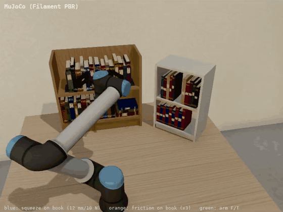
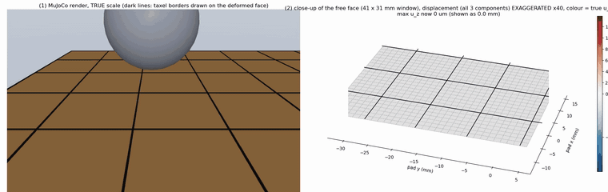

# Shear-Aware Agentic Grasping

**A thin tactile skin lets a parallel-jaw gripper feel shear; an LLM agent uses that touch as a tool to grasp gently and pull books off a shelf.**

AM/ME/CE 295 research project (Caltech, Fall 2026) · Dohyun ([@DHLeexpress](https://github.com/DHLeexpress)) · Jihoon ([@jhahn2](https://github.com/jhahn2))

<p align="center">
  
</p>
<p align="center">
  
</p>
<p align="center">
  <b>Top:</b> the librarian task in MuJoCo (2.5&times; speed): insert beside the book, squeeze with the tactile controller, pull, carry, shelve.
  <b>Bottom:</b> the PDMS skin (FEM flex) under a sphere, a box edge and a cube, true-scale render and surface &times;40.<br>
  Full videos: <a href="docs/media/librarian_demo.mp4">librarian demo with the 3D skin panel (MP4, 37 s)</a> ·
  <a href="docs/media/flex_contact_closeup.mp4">skin close-up, 8 objects (MP4, 42 s)</a>
</p>

> **Status: week 2 (Lab Report 2, v0).** Latest report: [Lab Report 2, week 2 v0 (PDF, 6 pages)](reports/LR2_week2_v0/LR2_week2_v0.pdf): agent design, the simulator and the verified skin model, evaluation plan · [Lab Report 1](reports/LR1_week02.md) · running log: [LOG.md](LOG.md) · [draft proposal](docs/proposal_draft.md) · [related work](docs/related_work.md)

## Idea
Parallel-jaw grippers know how far they closed and roughly how hard they squeeze, but not how close each contact is to slipping. Vision cannot see that either, least of all inside a packed shelf. Our thin tactile skin on a Robotiq 2F-140 finger measures the shear-strain field at the contact (~50 ms per frame today). We use it at three levels:

| | Layer | What we build | Compared against |
|---|---|---|---|
| **A** | Control | friction-margin grasp quality Q from measured shear → *squeeze just enough* + slip reflex | fixed force · slip-reactive regrasp · LLM-prior force (DeliGrasp-style) |
| **B** | Application | pull one book out of a tightly packed shelf *sideways*: shelves leave no headroom to lift, so thin fingers slide into the gaps, pinch and pull | scripted vision-only tilt → grasp → pull (Trixi-style) |
| **C** | Agent | LLM agent that calls tactile tools (`contact_state`, `shear_margin`, `incipient_slip`, …) to plan, monitor and recover | same agent with vision-only tools; learned visuo-tactile policy (RDP-style, stretch) |

## Repository layout
```
src/shear_agent/
  grasp_quality.py     friction-cone margin Q, required grip force, gentlest closure
  sim/toy_grasp.py     toy 1-D slip simulator + baseline controllers (evaluation harness)
  agent/tools.py       tactile tool schemas + input validation + offline mock gripper
  agent/llm.py         dependency-free LLM client (Anthropic / OpenAI-compatible) + MockLLM
  agent/loop.py        tool-use loop with turn/token accounting
  robot/               python-urx-compatible UR10e + Robotiq in MuJoCo, PDMS skin readout,
                       Filament/classic renderer, real-robot adapter (urx + Robotiq URCap socket)
  control/             controller interface for the contact phase + rule-based placeholder (MPC/MPPI/VLFA slots)
model/                 CAD: UR10e, Robotiq 2F-140, blade gripper_dohyun_v1 (+ PDMS), AGC tip (reference)
assembly/              MuJoCo models: robot + gripper, test scene, desk + bookshelf scene
scripts_sim/           librarian demo (viewer / video / real robot), gripper checks, asset generators
baseline/              VLA baseline (π0.5 via openpi) in the same MuJoCo cell + modular gripper/sensor kinematics:
                       baseline/README.md
vision/                wrist ZED Mini: hand-eye calibration bundle, real-time calibrated RGB-D, shelf + tabletop
                       perception, table safety filter, grasp controllers (scripted / PBVS / MPC): vision/README.md
scripts/               run_toy_benchmark.py · run_agent.py · check_llm_api.py · make_hero.py
tests/                 unit tests (stdlib unittest; pytest also works), no API key needed
docs/                  proposal draft, related-work note, refs.bib, figures
reports/               biweekly lab reports (LR1: Markdown + Word; LR2: LaTeX + PDF)
results/               small generated tables (raw data and agent logs stay out of git)
.githooks/             pre-commit hook that blocks API keys and .env files
.github/workflows/     CI: tests, offline agent episode, key scan
LOG.md                 running log
```
Hardware-side code (sensor acquisition, ROS 2 wrapper, UR10e/Robotiq drivers) will move into `sensing/` and `ros2_ws/`.

## Quickstart
```bash
git clone https://github.com/DHLeexpress/ME295.git && cd ME295
git config core.hooksPath .githooks           # once per clone: blocks committed keys
python -m venv .venv && source .venv/bin/activate
pip install -r requirements.txt               # numpy, matplotlib (+ pytest); or: pip install -e .
python -m unittest discover -s tests          # 36 tests, offline (incl. MuJoCo)
python scripts/run_toy_benchmark.py           # -> docs/figures/lr1_toy_benchmark.png, results/toy_benchmark.md
python scripts/run_agent.py --mock            # agent loop on the mock gripper, no key needed
cp .env.example .env                          # add your key, then:
python scripts/check_llm_api.py               # verifies key, network and tool use
python scripts/run_agent.py                   # same episode with the real model
```
Scripts and tests add `src/` to the path themselves, so no install is required.

## MuJoCo simulation (v0)
**How to use it: [docs/MuJoCo_simulator_v0.md](docs/MuJoCo_simulator_v0.md)** (install, commands, Python API, skin options, known limits). v0 is a working draft: it runs the full task, but the skin model and visuals are still being improved.
```bash
python -m mujoco.viewer --mjcf assembly/scene_bookshelf.xml        # browse the cell
python scripts_sim/run_librarian.py --viewer                        # live task + HUD (macOS: mjpython ...)
python scripts_sim/run_librarian.py --video results/librarian.mp4   # skin | MuJoCo | wrist camera video
python scripts_sim/run_librarian.py --backend urx --host <robot ip> # same task on the real UR10e
python scripts_sim/ablation.py                                      # skin vs fixed grip, 40 runs in parallel
```
- **Demo:** [docs/media/librarian_demo.mp4](docs/media/librarian_demo.mp4). The robot approaches shelf A horizontally, slides the blades beside a book, squeezes, pulls it out and lifts it, then carries it to shelf B and shelves it in the free slot.
- **Transfer to the robot:** the task is written against the python-urx API (`movej`, `movel`, `getj`, `get_tcp_force`, `gripper_action`, ...), so it runs on the UR10e unchanged.
- **Deformable PDMS:** the blades' 1.5 mm PDMS layer is a deformable body: 5 × 7 elastic cells by default (fast), or a MuJoCo finite-element flex (`make_blade_assets.py --pdms-model flex`). The skin panel shows, in the robot base frame (3D), the contact force and the deformation of each cell.
- **Report:** [docs/report_sim/librarian_sim.pdf](docs/report_sim/librarian_sim.pdf), 7 pages:
  - how MuJoCo computes force and displacement;
  - what the plots show, and which parts are assumptions about the sensor;
  - the control;
  - when the skin helps;
  - revision (Sec. 7-8): the 1.5 mm layer, the flex, the thin-layer model against exact solutions, contact and boundary conditions, the 3D panel, and when a high-level planner is needed.
- **MuJoCo flex study:** [docs/report_flex/flex_study.pdf](docs/report_flex/flex_study.pdf) (5 pages; [one-page summary](docs/report_flex/SUMMARY.md)): how flex computes, verification against exact solutions, cell size vs accuracy and cost, two MuJoCo 3.17 defects and their workarounds, and a [close-up contact video](docs/media/flex_contact_closeup.mp4).
- **Setup and backends:** per-OS setup, rendering backends and the controller slot are in [docs/SIM.md](docs/SIM.md); the gripper model is in [assembly/README.md](assembly/README.md).

## LLM API and keys (public repo)
- **Keys live only in `.env`**, which is git-ignored; `.env.example` is the template. The pre-commit hook and CI reject anything that looks like a key, and any `.env*` file other than the template.
- **Providers.** Anthropic Messages API by default (`ANTHROPIC_API_KEY`, `LLM_MODEL`). Any OpenAI-compatible endpoint works with `LLM_PROVIDER=openai`, `OPENAI_API_KEY`, `LLM_MODEL` and an optional `LLM_BASE_URL`.
- **Robust calls.** 60 s timeout; up to 4 retries with exponential backoff on 429 / 5xx / 529 and network errors, honouring `Retry-After`; capped output tokens and agent turns. Token usage is reported per run. The key is never printed, logged or put into error messages.
- **The model cannot command forces.** Every tool call is validated against its schema before it reaches the robot backend (skill names are an enum, 0 ≤ Q\* ≤ 0.8, no unknown arguments). Invalid calls come back to the model as errors. The low-level controller clamps grip force to the gripper's range.
- **Offline by default.** `MockLLM` runs the same loop without a key, so tests and CI never need one.

## Hardware (current)
UR10e · Robotiq 2F-140 (10–125 N grip force) · thin tactile skin on one finger, second side pending · sensing PC ↔ robot PC over Ethernet/ROS.

## Data and confidentiality
Raw sensor frames, recordings, agent run logs and internal lab material are **not** tracked (`data/`, `recordings/`, `results/agent_runs/`, `internal/` are git-ignored). Sensor-design details stay out of this public repo until they are cleared for publication.
