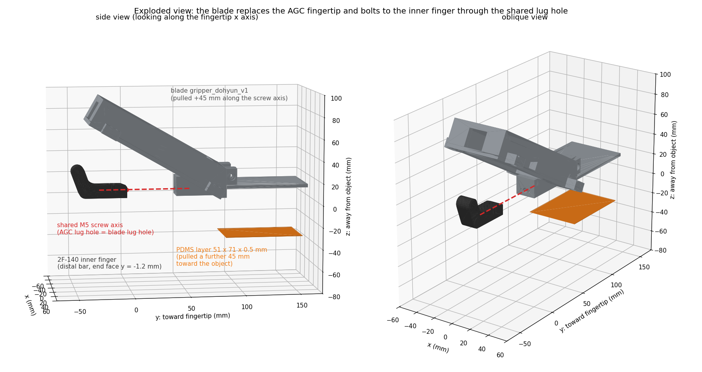
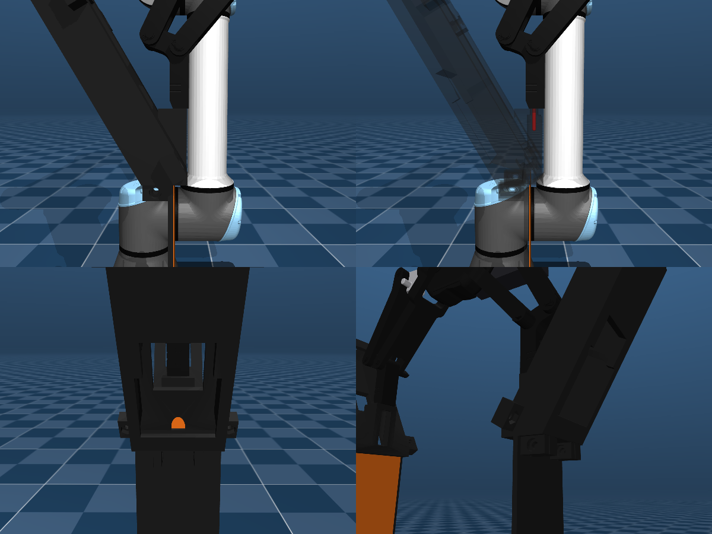
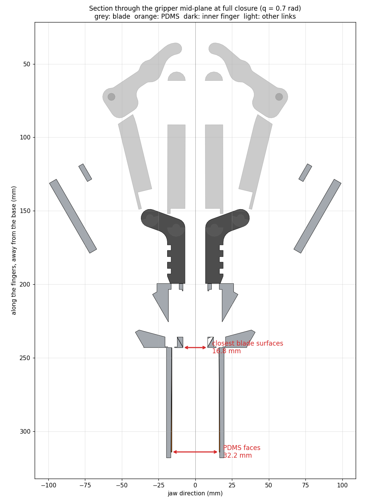

# Gripper assembly (MuJoCo)

UR10e + Robotiq 2F-140 with the custom blade `gripper_dohyun_v1` on both fingers + wrist camera. The blade **replaces the AGC fingertip**: it bolts to the 2F-140 inner finger through the same lug hole. Objects are held by its thin **PDMS layer** (orange), simulated as a deformable body.

| Figure | What |
|---|---|
|  | exploded view: inner finger, blade, PDMS, shared screw axis |
|  | connection close-up: profile, see-through with the screw axis, back (finger side), object side |
|  | mid-plane section at full closure with the measured gaps |
| `sim_assembly_open.png`, `sim_assembly_closed.png`, `sim_grasp.png` | whole gripper open, closed, holding a 300 g box on the PDMS |

| File | What |
|---|---|
| `ur10e_2f140.xml` | robot: arm (UR10e DH-exact, gravity-compensated), flange F/T sensor, coupling, wrist camera (`wrist_cam`), gripper, blades, deformable PDMS, sensors |
| `scene.xml` | test scene: floor, pedestal, 300 g box |
| `scene_bookshelf.xml`, `textures/` | librarian cell: desk, shelf A (source: `book_target` with 10 mm gaps beside it) and shelf B (destination, a 70 mm slot, turned 45° toward the robot), books, room, cameras `cam_main`/`cam_close`/`cam_side`; textures from `scripts_sim/make_scene_textures.py` |
| `blade_assets.xml`, `blade_geoms_{left,right}.xml`, `pdms_{left,right}.xml` | generated by `scripts_sim/make_blade_assets.py`, do not edit |

How to run it locally (viewer, video, real robot) and what the forces and displacements mean: [docs/SIM.md](../docs/SIM.md).

```bash
python scripts_sim/make_blade_assets.py model/gripper_dohyun_v1.stl   # after changing the blade STL
python scripts_sim/sim_gripper.py      # checks + MuJoCo snapshots -> docs/figures/sim_*.png
python scripts_sim/plot_connection.py  # exploded view + closed section
python -m unittest tests.test_mujoco_assembly
```

## How the blade is mounted
- **Finger side.** The 2F-140 inner finger ends in a 14 × 12 mm bar. In the fingertip frame (+y toward the tip, +z away from the object), its end face is at y = −1.24 mm and its screw hole runs along y at x = −0.2, z = 10.05 mm.
  - The hole height comes from the AGC pad. Its lug top sits flush with the bar top (15.26 vs 15.3 mm).
  - With the lug bolted there, the AGC contact faces touch at full closure, as on the real 2F-140.
- **Blade side.** The lug has the same hole pattern as the AGC lug (`model/agc_tip_140`, reference only): a Ø5.4 mm hole plus two Ø2.2 mm holes 4.5 mm either side. The main hole is at STL x = 6.07, z = −3.20 mm, and the lug end face at STL y = −44.37 mm.
- **Mount.** The blade's axes are the fingertip axes; STL −z faces the object. The hole sits on the finger's hole and the end face on the bar's end face, giving the translation (−6.27, 43.13, 13.25) mm (`*_blade_mount` frames).
  - Result: the blade clears the inner finger (0.06 cm³ hull overlap, 0.27 mm at the butt joint).
  - It clears every other link over the whole stroke.
  - The angled housing runs up and outward, as in the photo.

## Gaps
Measured along the jaw from the mesh vertices; the collision geometry agrees to within 0.6 mm.

| | Fully closed (q = 0.7) | Fully open (q = 0) |
|---|---|---|
| Closest blade surfaces: the mounting block's object-facing face (STL z = −8.52), just above the plate | **16.8 mm** | 145.5 mm |
| PDMS faces | **32.2 mm** | 160.9 mm |

- The mounting-block faces do **not** touch when closed. The face is only 5.3 mm from the screw axis, while the AGC contact face is 13.95 mm from it, so each blade sits 8.65 mm further back than an AGC pad would.
- The PDMS is a further 7.7 mm back.
- The fingertips travel about 24 mm toward the tip while closing. Anything that reaches above the PDMS's top edge meets the mounting block first.

## PDMS layer (deformable)
- **Geometry:** the 0.5 mm extrusion on the blade's flat face, 51.0 × 71.0 mm, found from the STL and split out for its own colour. The blade's own collision pieces under it are cut back to the plate face (STL z = −0.32), so the PDMS is what touches.
- **Deformable body:** the layer is **5 × 7 cells** (10.2 × 10.1 mm). Each cell is a column of PDMS bonded to the blade at its back face: a point mass on three slide joints in the PDMS frame (x across the blade, y toward the tip, z the face normal, +z into the layer).
  - Stiffness from the material: compression k_n = E(1−ν)/((1+ν)(1−2ν)) · A/t, shear k_s = E/(2(1+ν)) · A/t, Kelvin–Voigt damping τ·k.
  - This is the thin-layer limit of linear elasticity (Winkler foundation): with t = 0.5 mm ≪ 10 mm, each column deforms under its own traction only.
  - The joint positions `{side}_pdms_i_j_x/y/z` are the layer's deformation (µm at grasp loads: ~6 µm compression at 120 N).
  - Integrated by MuJoCo's `discrete` integrator, which is implicit in position; an explicit one would need a time step under ~16 µs.
- **Why not a MuJoCo flex:** a 3D flex (6 × 8 × 2 vertices, FEM) matched the analytical shear stiffness within 17% on a fixed plate. Bolted to the moving finger, its thin elements (aspect ratio 20:1 and more) made the effective-inertia solve ill-conditioned (contact and elastic forces stopped balancing).
- **Boundary conditions:**
  - Back face bonded to the blade (each cell's joints are anchored to the fingertip body).
  - Front face free, with frictional contact: one point per cell (a flat ellipsoid filling the cell), μ = 1.0, `priority = 2`.
  - Sides free.
  - Cells don't collide with each other (`contype=2 conaffinity=1`) or with their own blade (parent body).
- **Placeholders** (arguments of `make_blade_assets.py`):
  - material: E = 1 MPa, ν = 0.45 (real PDMS ≈ 0.49), τ = 1 ms, density 965 kg/m³;
  - cell grid: 5 × 7;
  - contact: μ = 1.0, `--solref 0.005 1 --solimp 0.9 0.95 0.002`, the compliance of the object's surface (a book cover), not of the PDMS.
- **Readout:** `shear_agent.robot.PDMSSkin` gives, per cell, the contact force from the solver (normal, shear) and the deformation (joint positions). Quasi-statically, stiffness × deformation equals the contact force (tested).

## Gripper control
- Actuator `fingers`: ctrl **0 = open … 255 = closed**, as on the Robotiq. One driven knuckle; the other five hinges follow it through joint equalities. The fingertips translate, so the blades stay parallel.
- **Force:** stiff servo (kp = 1000 N m/rad), with `forcerange` 24 N m. That gives 120–128 N per finger on 40–100 mm objects. Objects narrower than 32 mm can't be squeezed by the PDMS. `SimRobotiqGripper` maps the Robotiq force register 0–255 to 10–125 N per finger and speed 0–255 to 30–250 mm/s.
- **Linkage stiffness:** the mimic equalities use solref 0.001 s, so a 120 N squeeze tilts the fingertips < 0.1°. Softer settings leak normal force into the skin's shear reading.
- **Speed:** ramp ctrl (`gripper_ramp(..., speed=150)` mm/s) rather than stepping it.
- **Time step:** 0.5 ms, `discrete` integrator (implicit in position: stiff PDMS cells and servo gains), CG solver.

## Contact model
| Part | Collision geometry | friction (slide, torsion, roll) | solref |
|---|---|---|---|
| PDMS layer | 5 × 7 cells (one contact point each, flat ellipsoids) on elastic joints, `priority=2` | 1.0 (condim 3) | 0.005 1 (solimp 0.9 0.95 0.002) |
| Blade | 40 convex pieces (CoACD), plate piece cut back to the plate face | 0.4, 0.005, 0.0001 | 0.004 1 |
| 2F-140 links | convex hulls of the collision STLs | 0.6, 0.005, 0.0001 | default |

## Arm
- **Kinematics:** link offsets are the UR10e DH parameters (d1 0.1807, a2 0.6127, a3 0.57155, d4 0.17415, d5 0.11985, d6 0.11655). Menagerie rounds them and puts its `attachment_site` 16.6 mm inside the flange face. The flange pose now equals UR's tool0 to machine precision, which is what makes `getl()`/`movel()` transferable.
- **Gravity:** gravity compensation on the arm links (`gravcomp`), plus a feed-forward for the declared payload (`SimRobot.set_payload`), as the UR controller does.
- **F/T sensor:** `flange_force` / `flange_torque` sensors at the flange stand in for the UR10e's built-in F/T sensor (`SimRobot.get_tcp_force()`).

## Assumptions
- **Finger screw hole:** inferred from the AGC lug (flush tops, pads touching at closure). The PickNik finger mesh has no hole along its length.
- **Masses:** the blade is 0.12 kg (111 cm³ printed polymer), lumped on the fingertip body; PDMS is 1.7 g (50 mg per cell).
- **Camera:** a RealSense D435-sized box on a side bracket. Its position is approximate.
