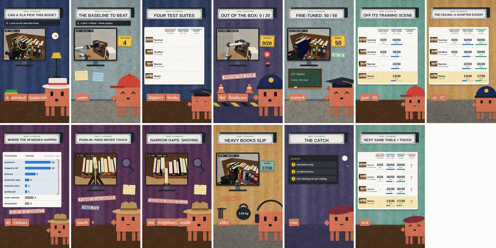
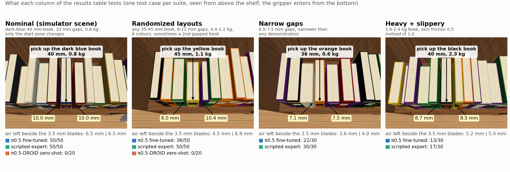
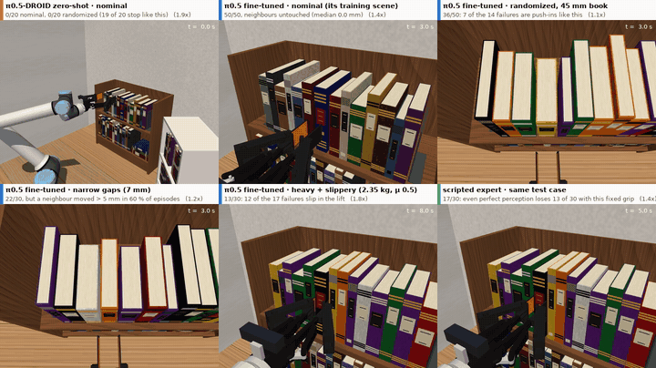

# VLA baseline: can a state-of-the-art VLA pick the designated book out of a packed shelf?

**Question.** Put the best open vision-language-action model (VLA) into our simulator cell (UR10e + Robotiq 2F-140 with
the PDMS-skin blade fingers, shelf A with ~10 mm of air beside the book) and measure what it can do. This is the
baseline our tactile skin has to beat; nothing here uses the skin.

**Model.** π0.5 from Physical Intelligence's openpi (`pi05_base`), fine-tuned with LoRA on scripted demonstrations
from this cell — the same model and recipe 2026 tactile-VLA papers use as their vision-only rival (TacVLA: LoRA on
`pi05_base` vs fine-tuned π0.5). Why π0.5 and not a newer model: [docs/SOTA_survey.md](docs/SOTA_survey.md).
Also measured: zero-shot π0.5-DROID (floor) and a privileged scripted expert (ceiling).

**Results** ([RESULTS.md](RESULTS.md): tables, figures, failure analysis, videos), task success with 95 % intervals:

| Policy | nominal (simulator scene) | randomized layouts | narrow gaps 6.5-7.5 mm | heavy 1.6-2.4 kg, μ 0.5 |
|---|---|---|---|---|
| π0.5-DROID zero-shot | 0/20 [0, 16 %] | 0/20 [0, 16 %] | – | – |
| **π0.5 fine-tuned** (LoRA, 251 demos) | **50/50** [93, 100 %] | **36/50** [58, 83 %] | **22/30** [56, 86 %] | **13/30** [27, 61 %] |
| scripted expert (privileged, ceiling) | 50/50 | 50/50 | 30/30 | 17/30 |

Fine-tuned π0.5 matches the expert only in the scene it was trained on. 33 of its 39 failures elsewhere happen at
contact, which is where the skin comes in: the blade tips push thick books deeper into the shelf, books slip out of
the fixed grip, and the gripper hits the shelf.

**60-second explainer of this table** (voice-over and simulation footage; the table builds up cell by cell as it
is read, then a table of failure modes; click for the MP4, 5.4 MB):

<a href="results/media/reel_results_60s.mp4"></a>

**What each column tests** (one test case per suite, seen from above the shelf):



**Why each row scores what it does** (re-runs of evaluation test cases; frame by frame in
[RESULTS.md](RESULTS.md#how-to-read-the-table-explainer-figures-and-videos)):

<p align="center"></p>

## Layout

```
baseline/
  embodiment/          modular kinematics of the robot as the VLA sees it (numpy only, also for the real robot)
    cards/*.toml         one card per hardware component, mirroring model/: arm_ur10e, coupling_robotiq,
                         gripper_robotiq_2f140, tool_blade_dohyun_v1, sensor_pdms_skin_v1, + the assembly card;
                         arm_franka_panda + virtual_franka_droid for zero-shot retargeting
    components.py        DH arm (FK, Jacobian, Levenberg-Marquardt IK), mount, linkage gripper, finger tool, sensor pad
    assembly.py          EndEffector: FK of flange -> fingertips -> blades -> pads -> TCP; jaw width <-> Robotiq register
    check.py             verifies a card stack against the MuJoCo assembly (python -m baseline.embodiment.check)
  sim/                 the task for policies
    scene.py             variations of shelf A (designated book, gaps, colours, mass, distractor, start pose)
    env.py               LibrarianPickEnv: cameras, servoj joint control, success / safety metrics
    expert.py            privileged scripted expert (run_librarian.py's motions, fixed grip) + demo recorder
    media.py             high-resolution close / top / wide views for figures (never shown to the policy)
  openpi_ext/          openpi side (runs in openpi's venv; openpi itself is not modified)
    librarian_policy.py  observation/action transforms (openpi's UR recipe)
    configs.py           pi05_librarian_lora (train) config, registered at runtime
    convert_to_lerobot.py, cli.py (norm-stats | train | serve)
  policies/            remote.py (openpi websocket client), adapters.py (fine-tuned joint chunks; DROID retargeting)
  scripts/             setup, download_checkpoints, collect_demos, evaluate, report, make_figures,
                       make_explainers (figures/clips that explain the table), make_media (side-by-side clips)
  reel/                60-second explainer reel of the results (paper-reel piece; reel/README.md)
  docs/SOTA_survey.md  which VLA is SOTA (arXiv, Nov 2026)
  tests/               python -m unittest discover -s baseline/tests -t .
  third_party/ data/ checkpoints/ results/eval/   (git-ignored: openpi clone, demos, LeRobot data, weights, raw logs)
```

## The robot as the VLA sees it: `embodiment/`

The VLA never sees MuJoCo; it sees joint angles, two images and, for end-effector policies, a TCP. Where the TCP is
depends on the whole stack, so the stack is described the way `model/` is organised: one card per component.

```
UR10e (DH, flange = tool0) -> Robotiq coupling (13.9 mm) -> 2F-140 four-bar (driver angle q, mimic joints)
  -> blade gripper_dohyun_v1 on each fingertip (lug-hole mount) -> PDMS skin pad on each blade (51 x 71 x 1.5 mm)
  -> TCP = midpoint of the two pads' free faces
```

- `EndEffector.load().fk(q_arm, q_grip)` returns flange, gripper base, fingertips, blades, pads, pad free faces and
  the TCP in the base frame. `tcp_pose6(width=...)` is the urx `set_tcp` for a given opening.
- **The sensor moves the TCP.** It is 292.3 mm from the flange at a 40 mm grasp (the hand-set `TCP` in
  `run_librarian.py` was 292 mm), and it travels 23.7 mm along the tool axis between open and closed because the
  2F-140 fingertips swing on an arc. The pads sit 0.21 mm off the fingertip axis, tilting the jaw axis by 0.5°.
- **Verified against the simulator:** `python -m baseline.embodiment.check` compares every frame with MuJoCo over
  random arm/gripper configurations: max error 1e-15 m / 0 rad; pad gap within 2.7 µm of MuJoCo's own distance
  query. Blade + skin are 3.5 mm thick through the pad (ray cast on the STL), which is what must fit in the gap.
- **Changing the design:** new blade or skin → copy its card, edit mesh / mount / size, regenerate the MuJoCo assets
  (`scripts_sim/make_blade_assets.py`), point a new assembly card at it, run the check. No code changes.
- The cards follow the assembly list in `model/DESCRIPTION.md` (UR10e → Robotiq 2F-140 → blade
  `gripper_dohyun_v1`, "version can be changed"); the AGC tip is not a card because the blade replaces it. A v2 blade
  is `tool_blade_dohyun_v2.toml` + `assembly_ur10e_2f140_dohyun_v2.toml`:

  ```toml
  # assembly_ur10e_2f140_dohyun_v2.toml            # tool_blade_dohyun_v2.toml
  arm = "arm_ur10e.toml"                           kind = "finger_tool"
  coupling = "coupling_robotiq.toml"               version = "v2"
  gripper = "gripper_robotiq_2f140.toml"           mesh = "model/gripper_dohyun_v2.stl"
  tool = "tool_blade_dohyun_v2.toml"               [mount]          # lug hole -> fingertip frame
  sensor = "sensor_pdms_skin_v1.toml"              pos = [...]      # from make_blade_assets.py / CAD
  ```

## Task and protocol: `sim/`

- **Task:** "pick up the {colour} book": slide the blades beside the designated book, squeeze, pull it fully out of
  the shelf, lift it ≥ 3 cm and hold it between both pads for 1 s (success, from simulation ground truth).
- **Robot interface for the VLA:** 10 Hz; observation = third-person camera `ext_cam` + `wrist_cam` (224 × 224),
  6 joint angles + gripper position, instruction; action = 6 absolute joint targets + gripper position request
  (openpi's UR5 recipe), executed like URScript `servoj` (joint speed capped at 1 rad/s). The gripper squeezes with a
  fixed force register (128 ≈ 67 N per finger, the simulator's no-skin baseline) — a vision-only VLA has no force
  channel. A wrist force above 150 N ends the episode as a UR protective stop.
- **Training data:** 251 successful demonstrations (40,159 frames at 10 Hz, 14.5–18 s each) of the privileged
  scripted expert (same motions as `run_librarian.py`): 191 randomized layouts (designated book = any ≥ 35 mm book,
  gaps 8–12 mm, 0.4–1.2 kg, 8 named colours, 31 % with a second gapped "distractor" book of another colour) + 60 in the
  simulator's own scene with perturbed start poses. The 49 discarded attempts were all 34 mm books, which the closed
  pads (32.2 mm) cannot squeeze reliably; they are excluded from every suite. Skin maps and wrist F/T are stored too
  (for the tactile follow-up) but not given to the model.
- **Test suites** (held-out seeds): `nominal` = the simulator's scene (dark blue 40 mm book, 10 mm gaps, 0.8 kg),
  start pose perturbed; `random` = the training distribution; `narrow` = 6.5–7.5 mm gaps; `heavy_lowmu` = 1.6–2.4 kg
  books with PDMS-cover friction 0.5 instead of 1.0.

## Reproduce

```bash
bash baseline/setup.sh                                     # openpi @ 215abfb, venv, pi05_base + pi05_droid
PY=baseline/third_party/openpi/.venv/bin/python; export HF_LEROBOT_HOME=$PWD/baseline/data/lerobot
python baseline/scripts/collect_demos.py --n-random 240 --n-nominal 60 --workers 48      # ~7 min
$PY -m baseline.openpi_ext.convert_to_lerobot --demos baseline/data/demos                 # ~4 min
$PY -m baseline.openpi_ext.cli norm-stats pi05_librarian_lora
CUDA_VISIBLE_DEVICES=0,3 XLA_PYTHON_CLIENT_MEM_FRACTION=0.5 \
  $PY -m baseline.openpi_ext.cli train pi05_librarian_lora --exp-name v1 --overwrite      # LoRA, 10k steps
bash baseline/scripts/eval_checkpoint.sh 9999 0 8000 --n-per-suite narrow=30,heavy_lowmu=30   # serve + evaluate + stop
#   openpi keeps only the newest checkpoint (max_to_keep=1): evaluate intermediate steps before the next save
$PY -m baseline.openpi_ext.cli serve pi05_droid --dir gs://openpi-assets/checkpoints/pi05_droid --port 8001 &
python baseline/scripts/evaluate.py --policy pi05_droid --port 8001 --suites nominal,random -n 20
python baseline/scripts/evaluate.py --policy expert --n-per-suite narrow=30,heavy_lowmu=30
python baseline/scripts/report.py && python baseline/scripts/analyze_failures.py && python baseline/scripts/make_figures.py
python baseline/scripts/make_media.py --suite nominal --index 0                         # side-by-side clip
# explainer figures and clips: re-run selected test cases with high-res views (servers as above), then
python baseline/scripts/evaluate.py --policy pi05_ft --port 8000 --suites random --indices 5 --media --videos 0 \
  --out baseline/data/media_runs                                       # likewise the other cases in make_explainers.py
python baseline/scripts/make_explainers.py suites && python baseline/scripts/make_explainers.py modes
#   60-second reel: baseline/reel/README.md
```

On a shared GPU set `XLA_PYTHON_CLIENT_PREALLOCATE=false` for the servers (JAX otherwise takes 75 % of the card).
