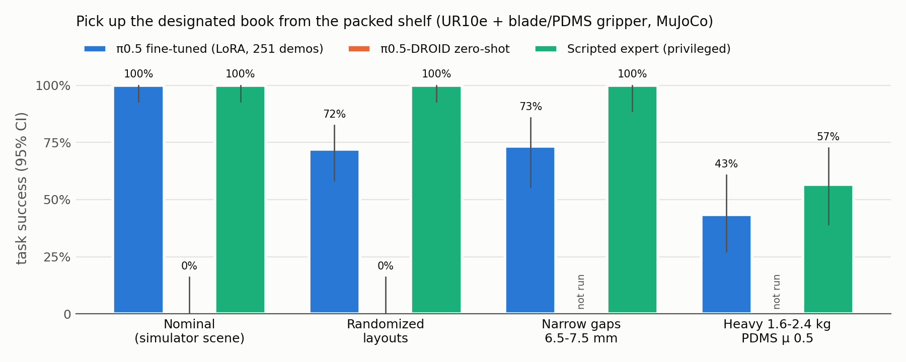
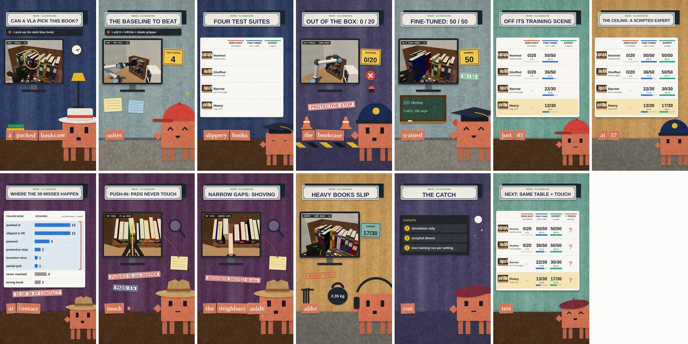
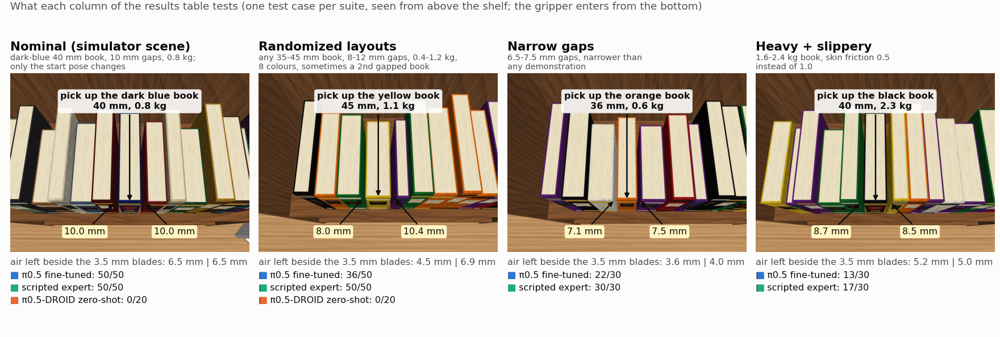
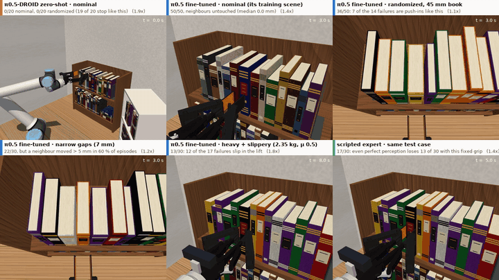
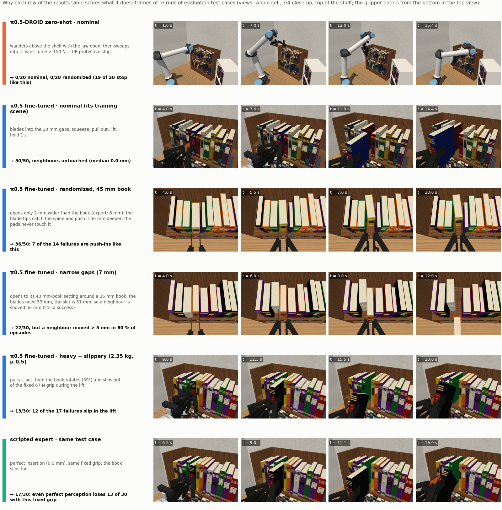
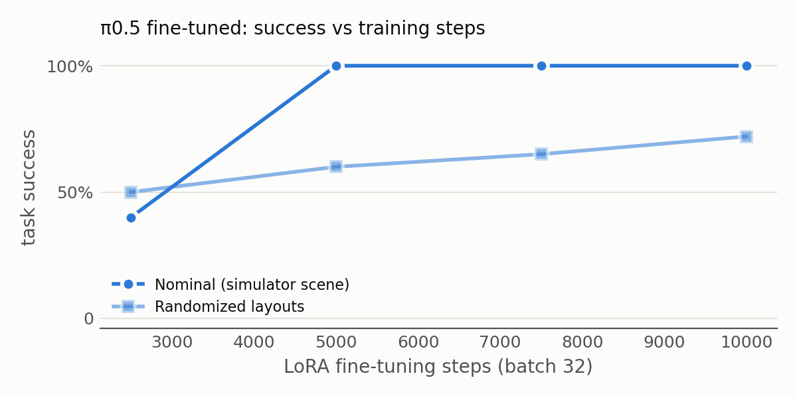
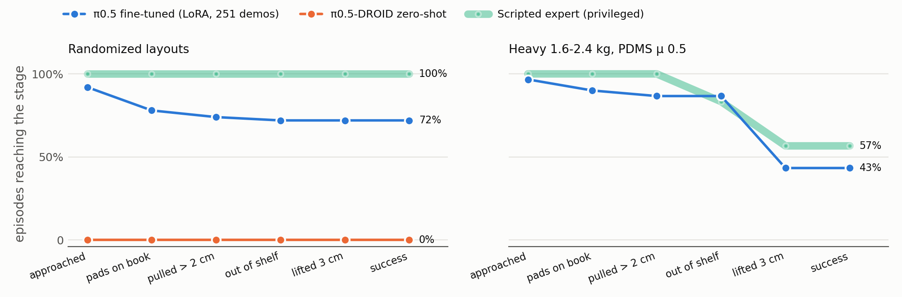

# What can a state-of-the-art VLA do in our cell? (results, 8-9 Nov 2026)

Task: **"pick up the {colour} book"** — slide the blades into the ~10 mm gaps beside the designated book, squeeze,
pull it fully out of shelf A, lift it 3 cm and hold it for 1 s, on the UR10e + 2F-140 + PDMS-blade gripper in MuJoCo
(the simulator's own cell). Protocol: [README.md](README.md#task-and-protocol-sim). Model choice:
[docs/SOTA_survey.md](docs/SOTA_survey.md). All numbers from simulation ground truth; raw episodes in
`results/eval/` (git-ignored), tables regenerated by `scripts/report.py` → [results/RESULTS_TABLES.md](results/RESULTS_TABLES.md),
failure modes by `scripts/analyze_failures.py` → [results/FAILURES.md](results/FAILURES.md).

## Headline

| Policy | nominal (simulator scene) | randomized layouts | narrow gaps 6.5-7.5 mm | heavy 1.6-2.4 kg, PDMS μ 0.5 |
|---|---|---|---|---|
| π0.5-DROID, zero-shot | 0/20 = **0 %** [0, 16] | 0/20 = **0 %** [0, 16] | – | – |
| **π0.5 fine-tuned** (LoRA on `pi05_base`, 251 demos, 10k steps) | 50/50 = **100 %** [93, 100] | 36/50 = **72 %** [58, 83] | 22/30 = **73 %** [56, 86] | 13/30 = **43 %** [27, 61] |
| Scripted expert (privileged poses, same fixed grip) | 50/50 = 100 % [93, 100] | 50/50 = 100 % [93, 100] | 30/30 = 100 % [89, 100] | 17/30 = 57 % [39, 73] |

Success with Wilson 95 % intervals. Videos: [results/media/compare_nominal_000.mp4](results/media/compare_nominal_000.mp4)
(same episode, three policies), [results/media/compare_narrow_001.mp4](results/media/compare_narrow_001.mp4).

**In one sentence:** out of the box the best open VLA does nothing useful on our robot. Fine-tuned on ~67 minutes of
demonstrations, it matches the privileged expert in the scene it was trained on, but it loses a quarter to a half of
the episodes as soon as the books, the gaps or the book's weight change. 33 of its 39 failures happen *at contact*,
where the cameras see little: the blade tips push the book deeper into the shelf, the book slips out of a fixed-force
grasp, or the gripper hits the shelf. The other 6 are wrong-book or never-reached errors.

### How to read the table (explainer figures and videos)

**60-second explainer reel** (voice-over and real simulation footage). The table builds up on screen cell by cell
as each number is read, followed by the failure-mode table of §3.2; every number is from this report:
[results/media/reel_results_60s.mp4](results/media/reel_results_60s.mp4). Source and rebuild: [reel/README.md](reel/README.md).

**The columns:** one test case per suite, seen from above the shelf, with the measured gaps and the scores of each row.

**The rows:** what each policy does in the cells that need explaining. The six clips run side by side in
[results/media/outcomes.mp4](results/media/outcomes.mp4); the key frames are below.

The clips come from re-running evaluation test cases with three extra high-resolution views (`sim/media.py`;
`scripts/evaluate.py --media`, outputs in the git-ignored `data/media_runs/`). The policy samples its actions, so
each re-run is a new episode of the same test case. The re-runs illustrate the failure modes and are never counted.
The failures mostly recur:
- **Randomized layouts:** of the 6 cases that failed at contact in the evaluation (5, 10, 27, 29, 41, 47), 4 failed
  again (3 push-ins, 1 partial pull) and 2 succeeded.
- **Heavy, slippery books:** all 4 re-run cases slipped in the lift again.

## 1. Zero-shot: π0.5-DROID (the open generalist, no data from our robot)

| Suite | success | protective stop (> 150 N) | approached the book | other books moved > 5 mm | median peak gripper contact |
|---|---|---|---|---|---|
| nominal (20) | **0/20** | 19/20 | 0/20 | 13/20 | 125 N |
| random (20) | **0/20** | 19/20 | 0/20 | 4/20 | 118 N |
| nominal, stop disabled (diagnostic, 10) | **0/10** | – | 0/10 | 10/10 (2 pulled out the *wrong* book > 5 cm) | 618 N |

- It never got both pads on the designated book. In the recorded episodes it keeps the jaw fully open, dips toward
  the tops of the books and strikes the middle board or the books with an open blade; with a real UR10e's 150 N
  protective stop the episode ends after a median of 2.1 s (nominal) and 4.9 s (random); its TCP never came
  closer than 13 cm (median) to the designated book's spine.
- This is a floor, not a fair baseline: the checkpoint commands a 7-joint Franka (desired q = measured q + 0.2 v at
  15 Hz). We map it through a virtual Franka whose TCP is pinned to our pad-centre TCP (`embodiment/` cards,
  `policies/adapters.py`); the virtual base was placed so the task's horizontal approach is reachable with joints
  mostly inside DROID's distribution, but the images (UR10e, blade gripper, rendered scene) are out of distribution.
- The survey's advice holds: there is no usable zero-shot VLA for this robot; a rival would fine-tune.

## 2. Ceiling: the privileged scripted expert (same fixed grip as the VLA)

| Suite | success | where it fails |
|---|---|---|
| nominal (50) | 50/50 | – |
| random (50) | 50/50 | – |
| narrow 6.5-7.5 mm (30) | 30/30 | – (it knows the gaps and centres the blades; the VLA cannot) |
| heavy 1.6-2.4 kg, PDMS μ 0.5 (30) | **17/30** | 5 slip during the pull, 8 slip in the lift |

- With perfect perception and a perfect insertion (0.0 mm lateral error), the *fixed* 67 N grip still fails 43 % of
  heavy, low-friction books. No vision-only policy can recover these: the information needed (incipient slip, the
  actual friction) is in the contact, not in the image. This is the skin's clearest opening (cf. the simulator's own
  ablation, `docs/SIM.md` §6, where the skin controller squeezes what each book needs).

## 3. π0.5 fine-tuned on our cell — the baseline to beat

**Setup.** openpi `pi05_base` with LoRA (`gemma_2b_lora` + `gemma_300m_lora`, the same recipe TacVLA uses for its
vision-only rival). Inputs: `ext_cam` + `wrist_cam` (224 × 224), instruction, state = 6 joints + gripper as π0.5's
discretised state tokens. Outputs: 1 s chunks (10 steps) of absolute joint targets + gripper position, trained as
deltas from the current joints (openpi's UR recipe); the first 5 steps are executed before re-planning. Batch 32,
10k steps, cosine LR 5e-5 → 5e-6, 3 h 34 min on two shared H100s (data parallel); training loss 0.072 → 0.002
([results/train_log_v1.txt](results/train_log_v1.txt)). Grip force fixed at register 128 (≈ 67 N per finger).

### 3.1 Learning curve

| LoRA steps | 2 500 | 5 000 | 7 500 | 10 000 |
|---|---|---|---|---|
| nominal | 8/20 (40 %) | 20/20 | 20/20 | 50/50 |
| randomized | 10/20 (50 %) | 12/20 (60 %) | 13/20 (65 %) | 36/50 (72 %) |

The trained scene saturates by 5k steps; the randomized layouts keep improving slowly, so more steps or more varied
demonstrations would likely help, but not past the physical limits in §3.3 (4).

### 3.2 Where the episodes end

| Suite | failures | pushed in | jammed | partial pull | slipped in lift | protective stop | insertion miss | wrong book | never reached |
|---|---|---|---|---|---|---|---|---|---|
| nominal | 0/50 | | | | | | | | |
| randomized | 14/50 | 7 | 2 | 1 | | | | 1 | 3 |
| narrow | 8/30 | 2 | 2 | | | 2 | 1 | 1 | |
| heavy, μ 0.5 | 17/30 | 3 | 1 | | 12 | | | | 1 |

- **Pushed in:** the blades went in within 3 mm of the centre line, but the blade tips pushed the book deeper into the
  shelf. It ended 55-64 mm deeper, and the pads never touched it.
- **Jammed:** the pads squeezed the book (68-70 N), but it came out less than 2 cm.

Definitions are in `scripts/analyze_failures.py`; per-checkpoint tables are in
[results/FAILURES.md](results/FAILURES.md). An earlier version of this report merged both modes into "jammed" and said
the pads touched the book. That holds for only 5 of those 17 episodes.

### 3.3 What the traces show

1. **Lateral aim is good.** The blades cross the plane of the spines with a median lateral error of 0.8-1.3 mm (expert
   0.0 mm); more than 3 mm in 0-13 % of episodes. On randomized layouts 35/46 well-aimed insertions succeed, so most
   failures happen *after* a well-aimed entry.
2. **It does not size the jaw to the book.** It opens the pads to roughly the 40 mm book's setting (median pad gap −
   book thickness +5.9 mm; 123 of the 251 demonstrations use a 40 mm book). For 44-45 mm books the margin falls to a
   median +2.4 / +4.7 mm (as little as +0.9 mm; −0.7 mm in the narrow suite) and success to 8/18, against 28/32 for
   books ≤ 41 mm (randomized suite; at 5k steps it was 0/7). The expert opens to the book + 6.0 mm every time.
   With so little spare width, the blade tips catch the spine and push the book back instead of sliding past it:
   - 12 of the 17 "pushed in" + "jammed" failures in §3.2 are such push-ins (8 of the 12 on 44-45 mm books). The
     pads never touch the book, while the blades and fingertips meet it with 8-46 N.
   - In the other 5 (all 44-45 mm books) the pads squeeze, but the book comes out less than 2 cm.
3. **In narrow gaps it shoulders through.** With 6.5-7.5 mm of air (narrower than any demonstration) it still opens as
   trained and pushes the neighbours aside: 73 % success, but another book moved > 5 mm in 60 % of the episodes
   (successful ones: median 7 mm, 90th percentile 62 mm) and 2 episodes hit the 150 N protective stop. The expert,
   which knows the gaps, centres the blades and moves nothing.
4. **Heavy, low-friction books slip out of the fixed grip.** 12 of its 17 failures are slips during the lift. It
   pulls the book out as often as the expert (87 % vs 83 %) but holds fewer through the lift (43 % vs 57 %); both are
   bounded by the fixed 67 N squeeze, which neither camera can tell is insufficient.
5. **Language grounding mostly works.** In the 28 episodes with a second gapped book of another colour it went to the
   designated book 26 times and never pulled the distractor. Its 2 wrong-book pulls happened without a distractor
   (it went for a packed neighbour).
6. **In the scene it was trained on it is as clean as the expert:** 50/50, neighbours moved a median 0.0 mm, 15.5 s per
   pick vs 14.7 s.

### 3.4 What this suggests for the skin (hypotheses for the next step, not results)

- **Grip force is the clearest opening.** On heavy / low-friction books the fixed grip loses 57 % (VLA) and 43 %
  (expert). The simulator's skin controller already squeezes what each book needs (`docs/SIM.md` §6). First test:
  the same fine-tuned VLA with the skin setting the force register (`ShearMarginGrasp`) on `heavy_lowmu`.
- **Push-ins beside thick books happen where the skin is blind.** In all 12 the pads read zero: the contact is on the
  blade tips and fingertips (8-46 N), and the wrist F/T peak (median 23 N) is not much above a successful pick's
  (20 N). The inner-face skin would therefore not see a push-in. Two things could: a sensor at the blade tip / front
  edge, or the F/T profile *during insertion* (instead of its peak).
- **The 5 true jams are visible to the skin:** the pads squeeze (68-70 N) but the book does not follow the pull.
  Every demonstration already stores both skins' maps (`tactile_left/right`) and the wrist F/T in the LeRobot
  dataset.
- **Neighbour contact in narrow gaps is on the blades' backs,** which the skin (on the inner faces) does not cover.
  The UR10e's wrist F/T sees it, so a force-only rival (ForceVLA-style) would target exactly this case; back-side
  sensing is a design option for the next blade (a new tool/sensor card in `embodiment/`).
- **For a clean comparison** keep the backbone (π0.5 + LoRA), the 251 episodes, the suites and the seeds identical,
  and add only the touch input.

## Threats to validity

- **Simulation only.** Rendered images, a perfectly known camera rig, no sensor noise; MuJoCo's soft contacts and
  regularised friction. The scene, books and lighting are the simulator's; the real cell will look different.
- **Scripted demonstrations.** The expert's demos are smooth and identical in style; human teleoperation is noisier but
  more varied. 251 demos (40 k frames) is in the range of 2026 fine-tuning studies (50-300 per task).
- **One training run per configuration** (no seed variance); success rates carry the Wilson intervals shown.
- **Synchronous inference.** The simulator waits for each action chunk, so policy latency (~0.1 s on an idle H100,
  ~1 s on our shared GPUs) does not affect the results; on the robot, chunking hides it.
- **Fixed grip force for the VLA.** A vision-only VLA has no force channel; we used the simulator's no-skin baseline
  force (register 128 ≈ 67 N per finger). A higher fixed force raises the heavy-book ceiling (125 N: 4/4 in the
  simulator's ablation) at the cost of squeezing every book hard.
