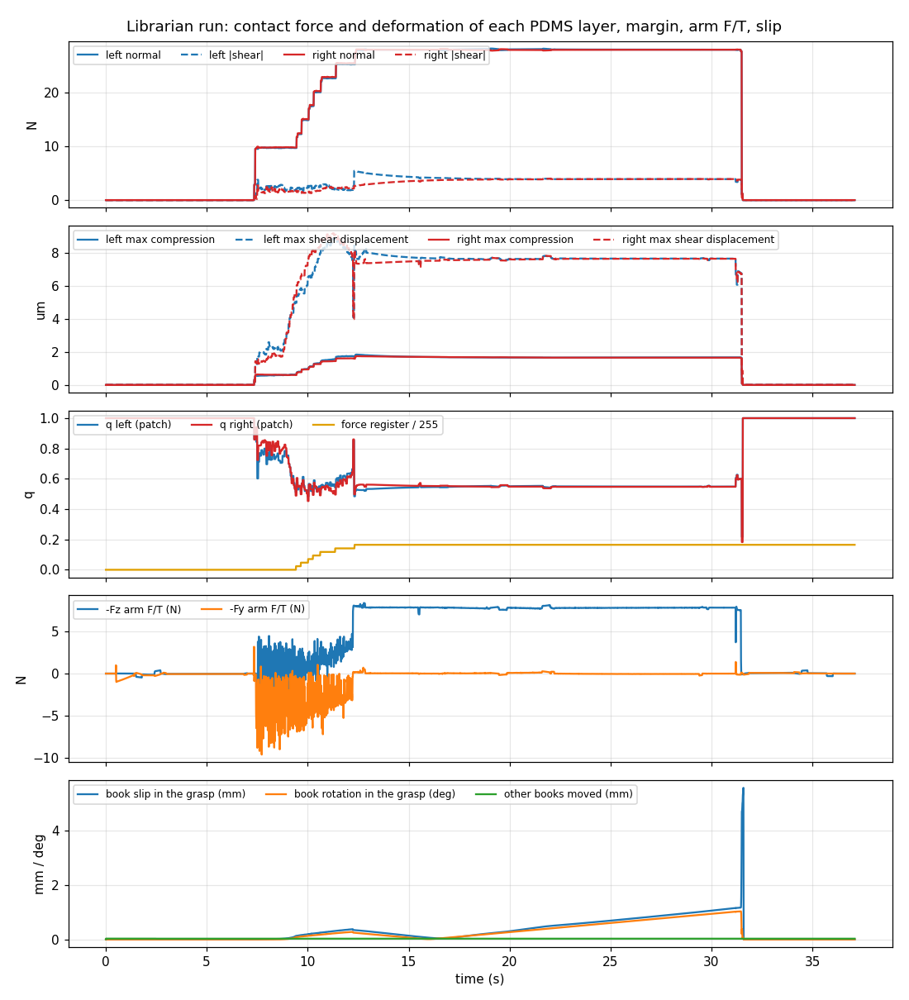

# MuJoCo simulation: setup, the librarian demo, and what the numbers mean

The simulated cell is a UR10e with a Robotiq 2F-140, the custom blade fingers `gripper_dohyun_v1` (their thin PDMS layer simulated as a deformable body), a wrist camera, a desk and two bookshelves. The librarian task takes one book out of shelf A by approaching horizontally and shelves it in the free slot of shelf B. The task code uses the **python-urx API**, so the same script drives the real robot. MuJoCo 3.17 or newer.

- **Demo video** (1080p): [media/librarian_demo.mp4](media/librarian_demo.mp4). Three panels: what the skin feels (contact force and deformation per cell), the MuJoCo view (Filament) with a tool-following close-up, and the wrist camera with the urx console.
- **Report** (3 pages): [report_sim/librarian_sim.pdf](report_sim/librarian_sim.pdf). How MuJoCo produces force and displacement from first principles, what each plotted quantity is and which parts are assumptions, the control and who decides what, and an ablation on when the skin helps.

The run's force, deformation and slip traces:



## 1. Install (Linux, macOS, Windows)

```bash
git clone https://github.com/DHLeexpress/ME295.git && cd ME295
python -m venv .venv && source .venv/bin/activate       # Windows: .venv\Scripts\activate
pip install -r requirements.txt                          # numpy, matplotlib, mujoco>=3.17, trimesh, imageio-ffmpeg
python -m unittest discover -s tests                     # ~10 s, includes the simulator tests
```

Python 3.10 to 3.12. Nothing else is needed for the viewer and the classic renderer. For video, `imageio-ffmpeg` ships an ffmpeg binary.

## 2. Look at it

| Goal | Command |
|---|---|
| Browse the scene (drag to rotate; double-click a body, Ctrl+drag to push it) | `python -m mujoco.viewer --mjcf assembly/scene_bookshelf.xml` |
| Watch the librarian task live, with HUD (joints, TCP, gripper registers, skin forces, cell maps) | `python scripts_sim/run_librarian.py --viewer` |
| Same on **macOS** (the passive viewer needs MuJoCo's launcher) | `mjpython scripts_sim/run_librarian.py --viewer` |
| Slow motion | add `--realtime 0.25` |
| Headless run: urx-style log, CSV and a summary plot in `results/sim_runs/librarian/` | `python scripts_sim/run_librarian.py` |
| Three-panel video: skin, MuJoCo, wrist camera | `python scripts_sim/run_librarian.py --video results/librarian.mp4` |
| Same task without the skin: constant grip (register 0..255 = 10..125 N per finger) | `python scripts_sim/run_librarian.py --controller fixed --grip-force 128` |
| Ablation, skin vs fixed grip across book mass and friction (40 runs in parallel) | `python scripts_sim/ablation.py` |
| Report figures, then the PDF | `python scripts_sim/make_report_figures.py`; `cd docs/report_sim && pdflatex librarian_sim.tex` |
| Gripper checks and figures (exploded view, closed section) | `python scripts_sim/sim_gripper.py`, `python scripts_sim/plot_connection.py` |

In the viewer, press `C` for contact points, `F` for contact forces and `Tab` for the UI panels. The fixed cameras (`cam_main`, `cam_close`, `cam_side`, `wrist_cam`) are under *Rendering → Camera*.

### Rendering backends (`--renderer auto|filament|classic`)

- **Filament** (MuJoCo 3.17+): physically based rendering with image-based lighting, soft shadows and MSAA. It uses **Vulkan** and needs no window, so it runs headless on GPU servers, on Linux desktops with NVIDIA/AMD/Intel drivers, and on Windows.
  - Check with `vulkaninfo --summary`.
  - Its own decorations aren't exposed to Python yet, so force arrows and contact markers are drawn by a classic overlay pass.
- **Classic OpenGL**: works wherever MuJoCo does, and `auto` falls back to it.
  - Headless Linux with a GPU: `MUJOCO_GL=egl` (the scripts set this when there is no `DISPLAY`).
  - No GPU: `MUJOCO_GL=osmesa` (`sudo apt install libosmesa6`), slow.
  - macOS / Windows: leave `MUJOCO_GL` unset.
  - macOS has no Vulkan by default, so expect the classic renderer there.

## 3. Same code, real robot

| Simulation (`shear_agent.robot`) | Real UR10e |
|---|---|
| `rob = SimRobot(scene)` | `rob = urx.Robot("192.168.x.x")` |
| `gripper = SimRobotiqGripper(rob, speed, force)` | `RobotiqSocket(host)` (URCap port 63352), or urx's `Robotiq_Two_Finger_Gripper(rob)` |
| `rob.getj()`, `getl()`, `get_pose()`, `get_tcp_force()`, `get_force()` | same |
| `rob.movej(q, acc, vel, wait)`, `movel(pose, acc, vel, wait)`, `translate`, `up/down`, `speedl`, `speedj`, `stopl`, `stopj`, `is_program_running()`, `set_tcp`, `set_payload` | same |
| `gripper.gripper_action(0..255)`, `open_gripper()`, `close_gripper()` | same |
| `gripper.set_position/set_force/set_speed`, `get_position()`, `get_object_status()` | `RobotiqSocket` (non-blocking register access) |
| `rob.sleep(dt)` advances simulated time | `real_ur.connect()` sets `rob.sleep = time.sleep` |

- **Poses** are urx's `[x, y, z, rx, ry, rz]`: base frame, metres, rotation vector.
- **Kinematics** are UR's published UR10e DH parameters. The sim's flange pose equals the controller's to machine precision (`tests/test_sim_robot.py`).
- **Run on the robot:** `python scripts_sim/run_librarian.py --backend urx --host <ip>` (asks for confirmation; `pip install urx` first).
- **Not tested on hardware from this repo.** Before the first real run:
  - verify `set_tcp`/`set_payload` on the pendant;
  - check the sign of `get_tcp_force()` with a known weight;
  - keep the speeds as they are.

## 4. Where the controller goes

The task is gross motion with urx calls, then the contact-rich phase in a controller loop (`shear_agent.control`):

```python
class MyController(Controller):        # MPC, MPPI, VLFA ... (placeholders in control/placeholders.py)
    rate_hz = 50.0
    def act(self, obs: Observation) -> Command:
        # obs: q, tcp_pose, tcp_force, Robotiq registers, tactile {"left","right": TactileFrame}, images
        return Command(tcp_velocity=[vx, vy, vz, wx, wy, wz], gripper_position=255, gripper_force=40)
```

`run(controller, rob, gripper, skins)` turns each Command into `rob.speedl(...)` and Robotiq register writes, so a new controller works in simulation and on the robot. For model-based control, roll the MuJoCo model forward from a copy of `rob.d` (`mujoco.MjData`, `mujoco.rollout`).

Two placeholders implement it (`shear_agent/control/margin.py`):

- **`ShearMarginGrasp`** (skin in the loop):
  - closes at the lowest force (10 N per finger) until both blades feel the book;
  - computes each blade's patch margin q from the skin; raises the Robotiq force register while q < q\* = 0.5 and pauses the arm while q < 0.2;
  - pulls the book out 0.21 m and lifts it 0.08 m;
  - aborts if q stays below 0.2 at full force for 1 s, and the task then pushes the book back into shelf A.
- **`FixedForceGrasp`** (no skin): the same motions at a constant force register. It is the ablation's baseline.

After the controller loop, urx moves carry the book to shelf B (`movel` via a waypoint that keeps the wrist away from the base axis) and slide it into the slot with a force-guarded `movel`. A guarded descent sets it down on the board, stopping when the board pushes back 3 N. The gripper then opens to the book + 6 mm and the arm retreats.

**Who decides what.** No learned or LLM agent is in this loop. Every phase switch is a hand-written threshold on a sensor:

| Phase | Ends on | Decided by |
|---|---|---|
| insert | wrist F/T > 15 N (abort) or the target reached | script |
| close | skin normal > 3 N on both blades | controller |
| squeeze / pause / abort | skin margin q | controller |
| shelve | F/T change > 10 N (unexpected contact), then +3 N on Fz (touch-down) | script |

On the real robot the script asks for a typed "yes" before any motion.

## 5. How MuJoCo defines force and displacement

The report ([report_sim/librarian_sim.pdf](report_sim/librarian_sim.pdf), Sec. 2) derives this from the equations of motion. In short:

**Bodies are rigid; contacts are constraints.** Each 0.5 ms step, MuJoCo finds the contacts between geoms and solves one convex optimisation for all constraint forces: contacts, joint limits and the finger linkage's equality constraints. Each contact gets a force in its own contact frame:

- a **normal force** (≥ 0, pushing the geoms apart);
- two **friction forces** tangent to the surfaces, inside the friction cone |f_t| ≤ μ f_n (elliptic). μ is the geom's `friction`; the PDMS cells' `priority` makes their μ = 1.0 win.

These are real forces in newtons: they hold the book up against gravity and obey Newton's laws. `mj_contactForce` returns them.

**Displacement** is a change of the state: body poses (`d.xpos`, `d.xquat`) and joint positions (`d.qpos`). A rigid body never strains, so deformation exists only where the model has degrees of freedom for it.

- **The PDMS layer is deformable.** Each blade's layer is 5 × 7 cells, each a column of PDMS on three elastic slide joints: compression k_n = E(1−ν)/((1+ν)(1−2ν)) · A/t and shear k_s = E/(2(1+ν)) · A/t.
  - This is the thin-layer limit of linear elasticity, valid because t = 0.5 mm is much smaller than a 10 mm cell.
  - The joint positions are the layer's deformation: ~1.7 µm compression and ~1 µm shear while holding the 0.8 kg book, with the placeholders E = 1 MPa, ν = 0.45.
  - MuJoCo's `discrete` integrator treats this stiffness implicitly. An explicit integrator would need a 16 µs step.
  - A 3D flex (MuJoCo's finite-element deformable) was tried first and dropped (see `assembly/README.md`).
- **Contacts are slightly soft.** The solver lets geoms overlap a little (`contact.dist < 0`). The force grows with the overlap and its rate, as a spring–damper set by `solref`/`solimp` (a numerical regulariser). On the PDMS cells it stands for the compliance of the object's surface (the book cover), not of the PDMS.
- **Friction is regularised.** There is no static/kinetic difference, and a sustained tangential load creeps slowly. `impratio = 100` keeps the creep under ~0.02 mm/s here.

What the panels show, and which parts are physics and which are assumptions:

| What you see | How it is computed | Status |
|---|---|---|
| Normal / shear force per cell (`TactileFrame.normal`, `.shear`; heat map and arrows) | Sum of the solver's contact forces on that cell, in the PDMS frame. Normal = into the skin; shear = in-plane drag along x (across the blade) and y (toward the tip). | model physics |
| Deformation per cell (`TactileFrame.deformation`; heat map and arrows) | The cell's joint positions: compression and shear displacement. Quasi-statically stiffness × deformation = contact force (tested to 2%). | placeholder E, ν |
| Patch margin q | 1 − √((\|T\|/μN)² + (\|M\|/μNρ)²): T summed shear, N summed normal, M the shear field's twist about the centre of pressure, ρ = (2/3)√(A/π) of the loaded area. It falls toward 0 as the patch nears sliding or twisting. | assumes μ = 1 |
| 20 Hz frames (`SkinSensor`) | The cells sampled every 2 ms and averaged over 50 ms frames. | assumed sensor |
| Arm F/T `rob.get_tcp_force()` | MuJoCo `force`/`torque` sensors at the flange (`attachment_site`), as the UR10e's built-in sensor: base frame, moments about the TCP, the declared payload's weight subtracted (as UR does). Holding the 0.8 kg book reads Fz ≈ −7.8 N. | as UR10e |
| Gripper force | The finger actuator's torque, capped by the force register: 10–125 N per finger (2F-140 data sheet), calibrated in `sim_gripper.py`. | data sheet |
| Slip, rotation, other books moved | Book pose relative to the TCP since the grasp closed; largest displacement of any other book. | sim only |

**The sensor itself is not modelled.** The skin panel is an idealised sensor: it reports exactly what the model computes, on the model's 5 × 7 grid, at an assumed 20 Hz, with no noise, drift or hysteresis. The real sensor's transduction, resolution, rate and calibration are not characterised yet. Mapping its output to these quantities is the open link to the hardware.

**Caveats:**

- **Load sharing:** how load splits among many contacts (35 cells × 2 blades) is set by the layer's and the contact's compliance. Read the cell maps as qualitative; net forces are exact.
- **Friction:** μ = 1.0 between PDMS and book cover is a guess. The margin q uses the same μ, so q is only as good as μ (see the ablation).
- **Placeholders:** the PDMS material (E, ν, damping), the cover compliance and the cell grid are arguments of `scripts_sim/make_blade_assets.py`.

## 6. When does the skin help? (ablation)

`python scripts_sim/ablation.py` runs the task 40 times in parallel: five grip policies × book mass 0.4 / 0.8 / 1.6 / 2.4 kg × true PDMS–cover friction μ = 1.0 or 0.5.
- **skin:** the skin controller above, which always assumes μ = 1.
- **fixed:** the same motions at a constant 10, 40, 70 or 125 N per finger, no skin.

Results go to `results/ablation/results.json` and [figures/sim_ablation.png](figures/sim_ablation.png).

| Grip policy | shelved, μ = 1 | shelved, μ = 0.5 | squeeze while holding (N per blade) |
|---|---|---|---|
| skin (assumes μ = 1) | 4 / 4 | 0 / 4 | 15 / 28 / 54 / 81 for 0.4–2.4 kg |
| fixed 10 N | 1 / 4 | 0 / 4 | 10 |
| fixed 40 N | 3 / 4 | 2 / 4 | 39 |
| fixed 70 N | 4 / 4 | 3 / 4 | 68 |
| fixed 125 N | 4 / 4 | 4 / 4 | 121 |

- **When the load isn't known in advance, the skin helps.** It squeezes what each book needs. A fixed grip has to be tuned for the heaviest book to match its success.
- **When μ is overestimated, it hurts.** While the patch slides, |T| = μN, so q = 1 − μ/μ̂ never falls below q\* = 0.5 if μ ≤ μ̂/2. The force is never raised and the abort never fires. A force-ratio margin is only as good as its μ.
  - The fix is slip detection from the shear field, or an online μ estimate.
- **Successful runs:** the book landed within 7.7 mm of the slot, slipped ≤ 1.7 mm and rotated ≤ 1.4° in the grasp, and other books moved ≤ 0.03 mm.
